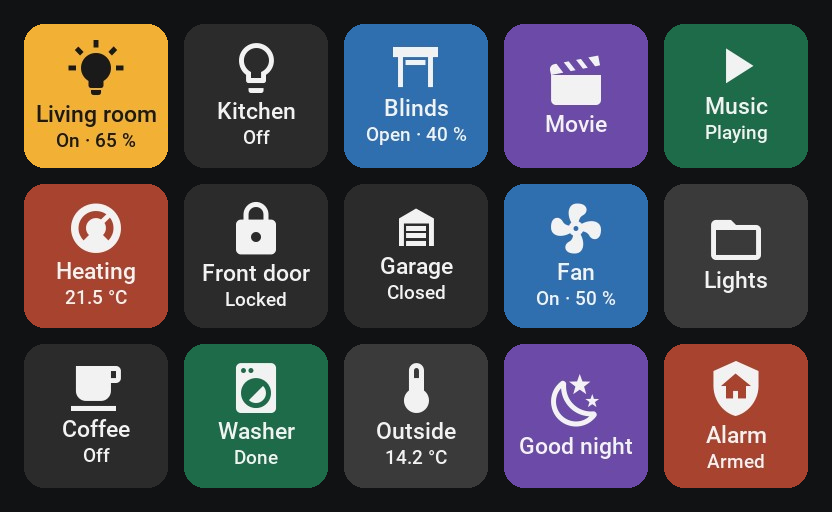

# Stream Assistant

<!-- TODO image: docs/images/logo.png – logo (list: docs/images/README.md) -->

Home Assistant integration that drives **Elgato Stream Decks** directly, with all
configuration in Home Assistant: no Stream Deck app, no Companion, no plugins. Design every
key, dial and page in a key editor in the sidebar; keys follow their entities live.

<!-- TODO image: docs/images/photo-dock-mk2.jpg – photo: Network Dock with a Stream Deck MK.2 showing a layout (list: docs/images/README.md) -->

A deck can be connected in three ways:

- **Elgato Stream Deck Network Dock:** over the network, no computer needed.
- **Stream Assistant Bridge:** Stream Decks plugged into a computer (Windows, macOS, Linux);
  the desktop version also shows **virtual decks** in a window.
- **Virtual panel:** a deck that only exists in Home Assistant, shown and pressed on a
  dashboard (wall tablets, phones), with any grid.

> **Beta.** Tested on real hardware so far: Network Dock with a Stream Deck MK.2. The bridge
> drivers for all other models are complete but untested; see
> [Devices and status](docs/devices.md).

## Documentation

- [Installation](docs/installation.md): HACS or by hand
- [Setup](docs/setup.md): docks, bridges, virtual panels
- [Stream Assistant Bridge](docs/bridge.md): download, start, pairing, autostart
- [Devices and status](docs/devices.md): every model and how far it is tested
- [Virtual and simulated panels](docs/virtual-panels.md)
- [Key editor](docs/editor.md): pages, keys, dials, templates, behaviour
- [Automations](docs/automations.md): events, actions, NFC tags
- [Troubleshooting](docs/troubleshooting.md)

## Features

- **Key editor** (sidebar, administrators): pages and folders; per key an entity, title,
  icon, colours and actions for short and long press (automatic per entity, open a page,
  back, any Home Assistant action). Live preview with real states; *Run* tests a press.
- **Dials and touch strips:** turning adjusts an entity directly (brightness, volume,
  position, temperature, values) or runs actions; the strip shows each dial's entity with a
  level bar.
- **Templates:** plan layouts before the hardware arrives, share one layout between decks,
  also of different sizes.
- **Behaviour:** night brightness (time window or sunset) and fading out when idle.
- **Entities:** an event entity per key, dial, touch strip and page button; brightness;
  connection state. Actions `stream_assistant.set_key` and `stream_assistant.clear_key`.
- **Stream Deck specials:** Neo page buttons and info screen, Studio LED rings and NFC
  reader (as Home Assistant tag scans), Pedal.
- **Robust:** docks are followed when their address changes, bridges and decks reconnect
  on their own, decks keep their layout while unplugged.

## Quick start

1. Install with HACS as a custom repository (`https://github.com/remostirnimann/StreamAssistant`,
   type *Integration*) and restart Home Assistant ([details](docs/installation.md)).
2. *Settings → Devices & services → Add integration → Stream Assistant*, choose how the deck
   is connected ([details](docs/setup.md)).
3. Open **Stream Assistant** in the sidebar and design the keys.

## Repository layout

- `custom_components/stream_assistant/`: the integration
  - `protocol/`: Home Assistant independent clients for the Network Dock (Cora TCP, Gen2
    HID reports) and the bridge (`bridge.py`)
  - `transport.py`, `capabilities.py`: how a deck is reached and what it can do
  - `bridge_hub.py`: bridge entries with several decks
  - `frontend/panel.js` (editor) and `frontend/card.js` (dashboard card): plain web
    components, no build step
- `bridge/`: the Stream Assistant Bridge (.NET 10: core library, console and desktop
  program, tests), see [bridge/README.md](bridge/README.md)
- `docs/`: user documentation and the [bridge protocol](docs/bridge-protocol.md)
- `scripts/`: tests without hardware, probes for a Home Assistant host

Protocol knowledge based on [node-elgato-stream-deck](https://github.com/Julusian/node-elgato-stream-deck) (MIT).

## Development and releases

- Pull requests go to `develop`; CI checks the integration and the bridge (tests with at
  least 90 % coverage, linters), hassfest and HACS.
- A release is a pull request from `develop` into `main`. Merging it builds the integration
  zip and the bridge for Windows, macOS and Linux, tags `vX.Y.Z` and publishes the files on
  the [releases page](https://github.com/remostirnimann/StreamAssistant/releases), with the
  changelog section as release notes.
- [CHANGELOG.md](CHANGELOG.md) lists the changes of every version; [ROADMAP.md](ROADMAP.md)
  the plans.

## License

MIT, see [LICENSE](LICENSE). Bundled assets: Material Design Icons font (Pictogrammers,
Apache 2.0) and Roboto Medium (Apache 2.0), see `custom_components/stream_assistant/assets/`.
