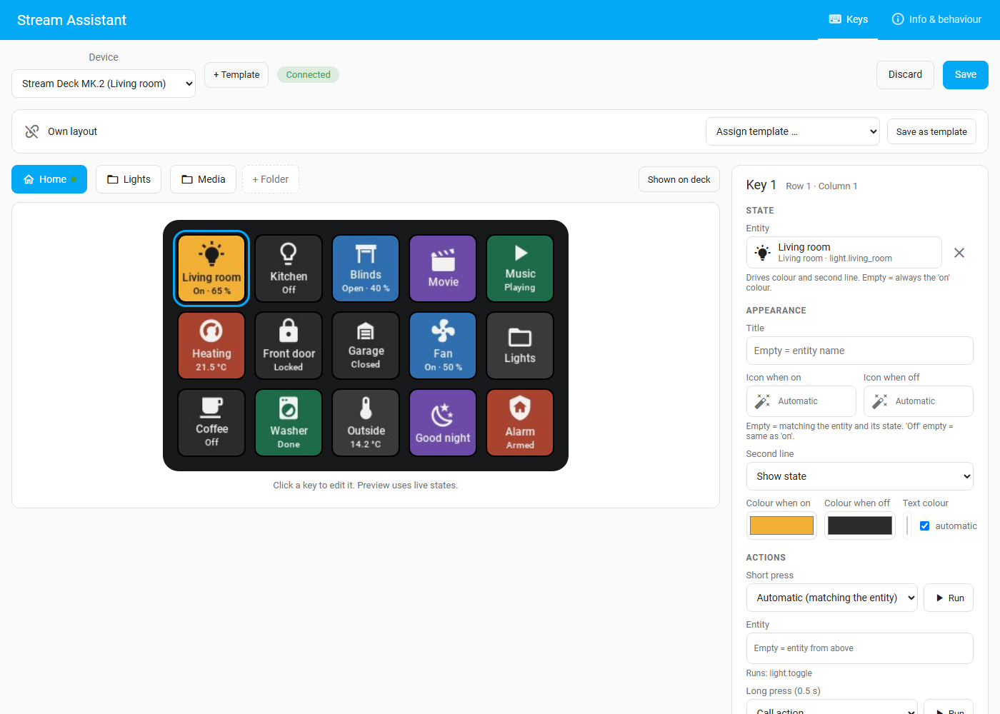

# Stream Assistant documentation

Stream Assistant drives Elgato Stream Decks (and later other control surfaces)
directly from Home Assistant. Everything is set up in Home Assistant: which key
shows what, what it does, pages and folders, brightness and behaviour. No Stream
Deck app, no Companion and no extra plugins are needed.

> **Early development.** Version 0.8 is a beta. See [Devices and status](devices.md)
> for what has been tried on real hardware.

## Guides

| Guide | What it covers |
|---|---|
| [Installation](installation.md) | Requirements, installing the integration with HACS or by hand, updating, removing |
| [Setup](setup.md) | Adding a Network Dock, a bridge, a virtual panel or a planning entry; what you get in Home Assistant |
| [Stream Assistant Bridge](bridge.md) | Installing and running the bridge on Windows, macOS and Linux, pairing, USB permissions, starting it automatically |
| [Devices and status](devices.md) | Every supported deck and connection, with its status (tested, untested, in development, planned) |
| [Virtual and simulated panels](virtual-panels.md) | Panels without hardware: virtual panels on a dashboard, virtual decks in the bridge window, simulated decks for testing |
| [Key editor](editor.md) | Pages and folders, keys, dials and touch strips, page buttons, templates, info and behaviour |
| [Automations](automations.md) | Entities, events, actions, NFC tags, examples |
| [Troubleshooting](troubleshooting.md) | Common problems and how to solve them |
| [Terms of use](terms.md) | Intended use (local network), your responsibility, no warranty or liability (also in German) |

For developers: [the bridge protocol](bridge-protocol.md) and the
[bridge source](../bridge/README.md).

## How it fits together

```text
┌──────────────────────── Home Assistant ─────────────────────────┐
│ Stream Assistant integration                                    │
│  · key editor (sidebar)        · entities and actions           │
│  · templates                   · dashboard card                 │
└──────┬──────────────────────────────┬────────────────────┬──────┘
       │ network                      │ network            │
┌──────┴──────────────┐ ┌─────────────┴──────────────┐ ┌───┴─────────────┐
│ Elgato Network Dock │ │ Stream Assistant Bridge    │ │ Virtual panel   │
│ └─ one Stream Deck  │ │ on a computer              │ │ on a dashboard  │
└─────────────────────┘ │ ├─ Stream Decks on USB     │ │ (no hardware)   │
                        │ ├─ virtual decks (window)  │ └─────────────────┘
                        │ └─ simulated decks         │
                        └────────────────────────────┘
```

- **Network Dock:** Elgato's dock connects one Stream Deck to the network. Home
  Assistant talks to it directly; no computer is needed.
- **Stream Assistant Bridge:** a small program for a computer (Windows, macOS,
  Linux). It offers every Stream Deck plugged into that computer to Home
  Assistant. The desktop version can also show virtual decks in a window.
- **Virtual panel:** a deck that only exists in Home Assistant and is shown and
  pressed on a dashboard, for example on a wall tablet.

All decks, however they are connected, are set up the same way in the key editor.


