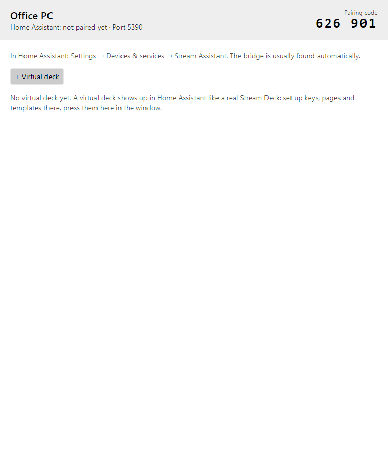
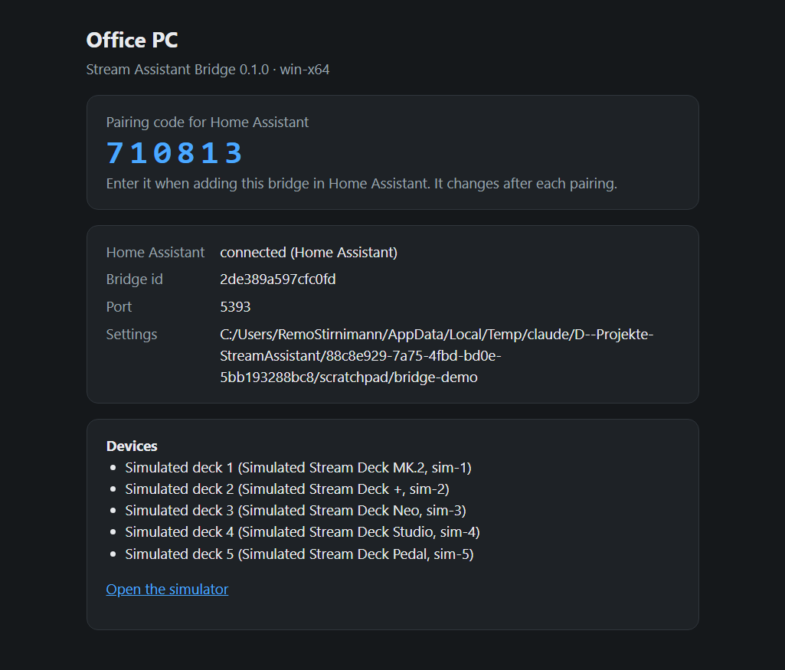

# Stream Assistant Bridge

The bridge is a small program for a computer with Stream Decks attached by USB. It offers
them to Home Assistant over the network, using the vendor-neutral
[bridge protocol](bridge-protocol.md). It does not draw anything itself: Home Assistant
decides what every key shows and does.

There are two versions, with the same features:

| Version | For |
|---|---|
| **Console** (`stream-assistant-bridge`) | Servers, Raspberry Pi, running in the background; no window |
| **Desktop** (`stream-assistant-bridge-desktop`) | Windows, macOS and Linux desktops; a window with the connection state, the pairing code and [virtual decks](virtual-panels.md#virtual-decks-in-the-bridge-window) |

Each is a single file and needs nothing else installed (no .NET, no Python).

## Install

The installers set the console bridge up as a service: it starts with the computer, runs
without anyone logged in, and Home Assistant can update it (see [Updates](#updates)).

### Windows

Download `stream-assistant-bridge-<version>-win-x64.msi` from the
[releases page](https://github.com/remostirnimann/StreamAssistant/releases) and run it.
It installs the bridge for all users:

- program in `C:\Program Files\Stream Assistant Bridge`, settings and log
  (`bridge.log`) in `C:\ProgramData\Stream Assistant Bridge`;
- the Windows service *Stream Assistant Bridge*, started automatically and restarted if
  it fails;
- a firewall rule for the bridge (Home Assistant connects on TCP port 5390, the bridge
  announces itself via mDNS);
- a start menu entry *Stream Assistant Bridge* that opens the status page with the
  pairing code.

The installer is not signed yet: Windows SmartScreen may warn. Choose
*More info → Run anyway*. Uninstall it in *Settings → Apps*; the settings (and so the
pairing) stay in `C:\ProgramData\Stream Assistant Bridge`.

<!-- TODO image: bridge-msi-start-menu (the start menu entry and the status page with the pairing code) -->

### Linux and macOS

```bash
curl -fsSL https://raw.githubusercontent.com/remostirnimann/StreamAssistant/main/bridge/install.sh | sudo sh
```

On macOS, run it without `sudo`. The script picks the right file for the computer
(also Alpine and ARM), checks its checksum, and

- **Linux:** installs the program in `/opt/stream-assistant-bridge`, keeps the settings
  in `/var/lib/stream-assistant-bridge`, creates the user `stream-assistant`, allows it
  to use Stream Decks (udev rule) and sets up the systemd service
  `stream-assistant-bridge`. The pairing code is in the log:
  `journalctl -u stream-assistant-bridge | grep -i pairing`.
- **macOS:** installs the program and its settings in
  `~/Library/Application Support/Stream Assistant Bridge` and a LaunchAgent that starts
  it when you log in. Log: `~/Library/Logs/stream-assistant-bridge.log`.

Options go after `sh -s --`, for example
`curl -fsSL … | sudo sh -s -- --version 0.9.0`:

| Option | What it does |
|---|---|
| `--version X.Y.Z` | Installs this version instead of the newest one |
| `--uninstall` | Removes the service and the program; the settings (pairing) stay |
| `--uninstall --purge` | Removes the settings and, on Linux, the user too |

Without systemd (for example on Alpine with OpenRC) the script installs the program and
shows the command to start it with.

### Desktop version and manual install

The desktop version (with a window and [virtual decks](virtual-panels.md#virtual-decks-in-the-bridge-window))
and the console version are also available as plain files on the
[releases page](https://github.com/remostirnimann/StreamAssistant/releases), in the same
version as the integration:

| Computer | Console | Desktop |
|---|---|---|
| Windows (64 bit) | `stream-assistant-bridge-<version>-win-x64.zip` | `stream-assistant-bridge-desktop-<version>-win-x64.zip` |
| macOS, Apple silicon | `…-osx-arm64.tar.gz` | `…-desktop-…-osx-arm64.tar.gz` |
| macOS, Intel | `…-osx-x64.tar.gz` | `…-desktop-…-osx-x64.tar.gz` |
| Linux, PC (64 bit) | `…-linux-x64.tar.gz` | `…-desktop-…-linux-x64.tar.gz` |
| Linux, Raspberry Pi (64 bit) and other ARM | `…-linux-arm64.tar.gz` | `…-desktop-…-linux-arm64.tar.gz` |
| Alpine Linux (e.g. Home Assistant OS add-ons) | `…-linux-musl-x64.tar.gz` / `…-linux-musl-arm64.tar.gz` | – |

`SHA256SUMS.txt` lists the checksums of all files. Run only one bridge per computer
(the installed service and the desktop version would both use port 5390); to run both,
give one of them another `--port`.

**Windows:** unpack the zip into a folder of your choice and start
`stream-assistant-bridge-desktop.exe` (or `stream-assistant-bridge.exe` in a terminal).
SmartScreen may warn (*More info → Run anyway*). When the Windows firewall asks, allow
access for **private networks**.

**macOS:**

```bash
mkdir -p ~/Applications/StreamAssistantBridge
tar -xzf stream-assistant-bridge-desktop-<version>-osx-arm64.tar.gz -C ~/Applications/StreamAssistantBridge
xattr -dr com.apple.quarantine ~/Applications/StreamAssistantBridge
~/Applications/StreamAssistantBridge/stream-assistant-bridge-desktop
```

The `xattr` line is needed because the files are not signed yet; without it macOS refuses
to start them. If macOS asks for permission to accept incoming network connections, allow it.

**Linux:**

```bash
mkdir -p ~/stream-assistant-bridge
tar -xzf stream-assistant-bridge-desktop-<version>-linux-x64.tar.gz -C ~/stream-assistant-bridge
~/stream-assistant-bridge/stream-assistant-bridge-desktop
```

For Stream Decks on USB the bridge needs access to the HID devices. Create
`/etc/udev/rules.d/70-streamdeck.rules` with:

```text
SUBSYSTEM=="hidraw", ATTRS{idVendor}=="0fd9", MODE="0660", TAG+="uaccess"
```

then run `sudo udevadm control --reload-rules && sudo udevadm trigger` and plug the
decks in again. `TAG+="uaccess"` gives the logged-in user access (the install script
sets this up for its service user itself). The bridge also needs `libudev` (installed on
almost every distribution; Alpine: `apk add eudev-libs`).

## First start and pairing

When the bridge starts, it

- creates its settings (`bridge.json`) with a unique bridge id,
- shows a **6-digit pairing code**: in the desktop window, in the console log, and on the
  status page `http://localhost:5390` (only on that computer),
- announces itself in the network, so Home Assistant finds it.



Add it in Home Assistant as described in [Setup](setup.md#stream-assistant-bridge).
After 5 wrong codes the bridge waits a minute before it accepts codes again.

One Home Assistant is connected at a time. If a second one connects, it takes over and
the first one is disconnected and tries again later, so two Home Assistant instances would
keep taking turns: pair a bridge with one Home Assistant only.

## Options

Options are given on the command line (also for the desktop version, for example in a
shortcut):

| Option | Default | What it does |
|---|---|---|
| `--name "Office PC"` | computer name | Name shown in Home Assistant |
| `--port 5390` | 5390 | TCP port for Home Assistant and the status page |
| `--config-dir <folder>` | see below | Where `bridge.json` is kept. Only one bridge can use a folder at a time |
| `--usb false` | on | Turns the Stream Deck USB driver off (for example on a computer that only offers virtual decks) |
| `--mdns false` | on | Turns the network announcement off; add the bridge in Home Assistant by address |
| `--simulate 5x3,plus` | – | Adds [simulated decks](virtual-panels.md#simulated-decks) for testing |
| `--unpair-all` | – | Forgets all paired Home Assistant instances; they must pair again |

The installers also set `--service true` (a service manager restarts the bridge after an
update) and, on Windows, `--install-kind msi` (updates run the new installer).

Without `--config-dir`, the settings folder is `%APPDATA%\stream-assistant-bridge` on
Windows and `~/.config/stream-assistant-bridge` on macOS and Linux (the installers use the
folders named under [Install](#install)). It holds the bridge id, the
paired clients (only hashes of their tokens), the bridge name and the virtual decks. Keep
it when you update the bridge, otherwise Home Assistant has to pair again and sees a new bridge.

## Stream Decks on USB

- Plug decks in or out at any time; they appear in Home Assistant within a few seconds.
- Several decks per computer are fine. Each deck is known by its serial number, so it
  keeps its layout when it moves to another USB port.
- **Close the Elgato Stream Deck app** (also in the tray / menu bar) and Companion: a deck
  can be driven by only one program. When a deck is busy, the bridge keeps trying and takes
  it over once it is free.
- When the bridge ends, the decks show the Elgato logo again.

Which models are supported, and how far they are tested, is listed in
[Devices and status](devices.md).

## Start automatically

The installers do this already. For the desktop version:

- **Windows:** press <kbd>Win</kbd>+<kbd>R</kbd>, enter `shell:startup` and put a shortcut
  to `stream-assistant-bridge-desktop.exe` into the folder that opens. Add options to the
  shortcut's target if needed.
- **macOS:** add `stream-assistant-bridge-desktop` in *System Settings → General → Login Items*.
- **Linux:** most desktops have an *Autostart* setting; add `stream-assistant-bridge-desktop` there.

## Updates

The bridge and the integration are released together, with the same version. Each bridge
has an **update entity** in Home Assistant (on the bridge's device page and under
*Settings → Updates*): when the integration is updated and the bridge runs another
version, the entity offers the matching bridge version.

<!-- TODO image: ha-bridge-update (the bridge update in Settings → Updates) -->

- **Install** downloads the release on the bridge's computer, checks it against
  `SHA256SUMS.txt`, replaces the program and restarts the bridge. Home Assistant shows the
  progress and waits until the bridge is back with the new version; the decks stay
  configured.
- **Automatic updates:** on the bridge's entry choose *Configure* and turn on
  *Update the bridge automatically*. The bridge then follows every integration update on
  its own. A failed automatic update is not repeated for the same version; install it
  from the update entity instead.

Bridges installed with the installers, and the downloaded console and desktop files, can
update themselves. Bridges started with `dotnet run` (development) show their version but
offer no install. Development versions of the integration offer no bridge update.

Without Home Assistant: run the [installer](#install) of the new version again, or replace
the files by hand (keep the settings folder).

## Status page

`http://<computer>:5390/` shows the bridge name and id, whether Home Assistant is
connected, and the decks. The pairing code and the settings folder are shown only when the
page is opened on the computer itself.



`http://localhost:5390/sim` is the
[simulator](virtual-panels.md#simulated-decks) (only on that computer).
