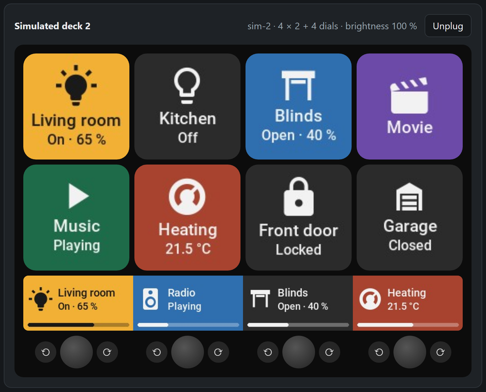
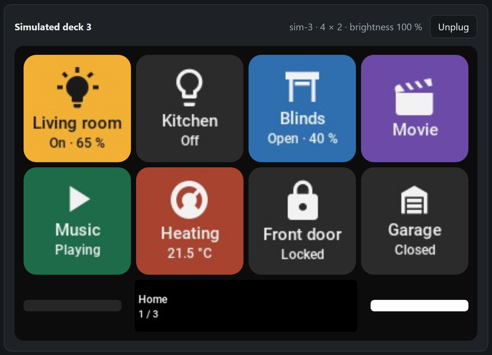
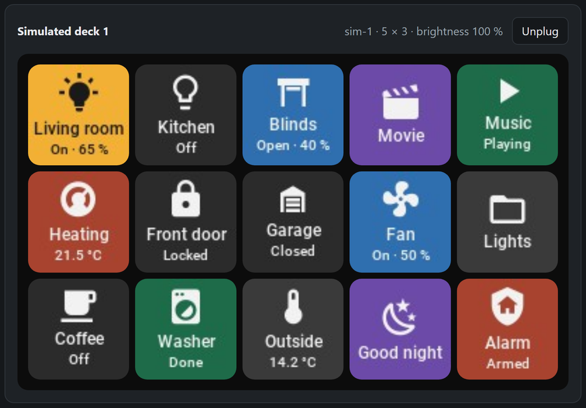
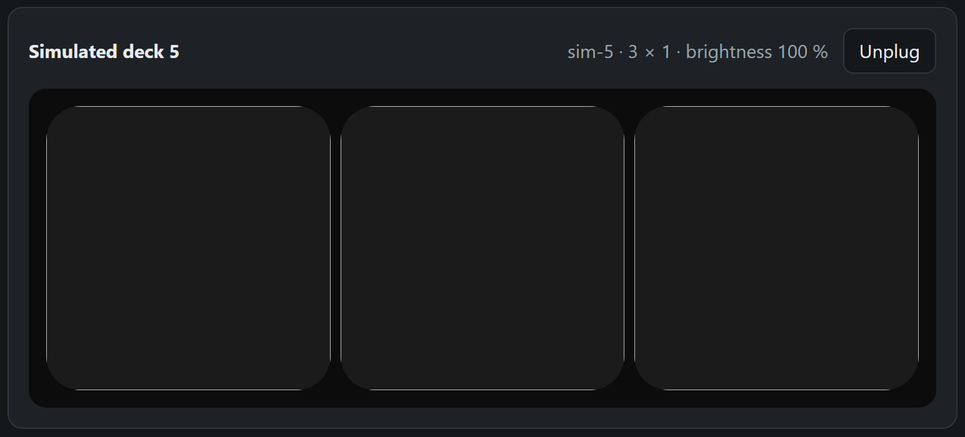
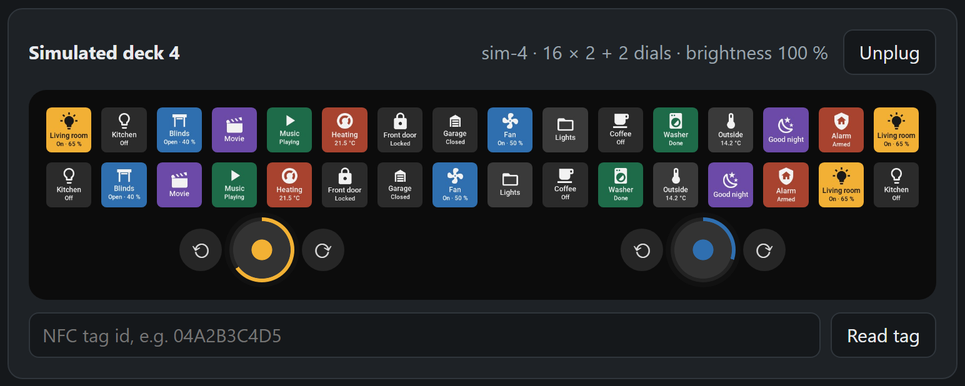

# Devices and status

What Stream Assistant can drive, and how far each part has been tried. The status is
honest on purpose: most drivers follow the reference implementation
[node-elgato-stream-deck](https://github.com/Julusian/node-elgato-stream-deck) byte for byte
and are covered by automated tests with simulated hardware, but only some have met a real
device.

| Status | Meaning |
|---|---|
| ✅ **Tested** | Tried on real hardware and works |
| 🧪 **Untested** | Implemented and covered by automated tests and simulations; not yet tried on the real device. Please [report](https://github.com/remostirnimann/StreamAssistant/issues) how it works |
| 🚧 **In development** | Being built; not in a release yet |
| 📋 **Planned** | On the [roadmap](../ROADMAP.md), not started |

## Elgato Stream Decks

| Model | Keys | Extras | Network Dock | Bridge (USB) |
|---|---|---|---|---|
| Stream Deck MK.2 (also *Scissor* keys) | 15 (5×3), 72 px | – | ✅ Tested (dock firmware 1.01.013) | 🧪 Untested |
| Stream Deck Original v2 | 15 (5×3), 72 px | – | 🧪 Untested | 🧪 Untested |
| Stream Deck XL (both versions) | 32 (8×4), 96 px | – | 🧪 Untested | 🧪 Untested |
| Stream Deck + | 8 (4×2), 120 px | 4 dials, touch strip 800×100 | 📋 Planned | 🧪 Untested |
| Stream Deck Neo | 8 (4×2), 96 px | 2 lit page buttons, info screen 248×58 | 📋 Planned | 🧪 Untested |
| Stream Deck Studio | 32 (16×2), 144×112 px | 2 dials with LED rings, NFC reader | 📋 Planned (also has its own network port) | 🧪 Untested |
| Stream Deck Mini (all versions) | 6 (3×2), 80 px | – | – | 🧪 Untested |
| Stream Deck (first model, 2017) | 15 (5×3), 72 px | – | – | 🧪 Untested |
| Stream Deck Pedal | 3 pedals | no display | – | 🧪 Untested |
| Stream Deck Modules 6 / 15 / 32 | 6 / 15 / 32 | – | – | 🧪 Untested |
| Stream Deck + XL | 36 (9×4), 112 px | 6 dials, touch strip | – | 📋 Planned |

"–" in the dock column: Elgato's Network Dock does not take this model.

How the extras are used:

- **Dials** (Stream Deck +, Studio): turn to adjust the dial's entity (brightness, volume,
  position, temperature, values) or to run actions; push for the short and long actions.
- **Touch strip** (Stream Deck +): above each dial its part of the strip shows the dial's
  entity with a level bar; tap or hold it like pushing the dial; swipes are events.
- **LED rings** (Studio): show the dial's colour and its entity's level.
- **Page buttons** (Neo): previous and next page, lit when there is a page in that direction.
- **Info screen** (Neo): the name and number of the page shown.
- **NFC reader** (Studio): tags read there are Home Assistant tag scans.
- **Pedal**: three keys without display; presses run actions and fire events.

Details in the [key editor](editor.md) and [automations](automations.md) guides.

How the models look with their controls (here in the bridge's [simulator](virtual-panels.md#simulated-decks),
which shows them the way Home Assistant draws them):

| Stream Deck + | Stream Deck Neo |
|---|---|
|  |  |
| **Stream Deck MK.2** | **Stream Deck Pedal** (no display) |
|  |  |

Stream Deck Studio, with its LED rings and the field to read an NFC tag:

## Ways to connect

| Connection | Status | Notes |
|---|---|---|
| Elgato Stream Deck Network Dock | ✅ Tested | One deck per dock; found automatically; follows IP changes |
| Stream Assistant Bridge, Windows (console and desktop) | ✅ Tested | With virtual and simulated decks; USB decks 🧪 untested |
| Stream Assistant Bridge, Alpine Linux ARM64 (console) | ✅ Tested | Ran on a Home Assistant Yellow with simulated decks |
| Stream Assistant Bridge, other Linux, macOS (console and desktop) | 🧪 Untested | Built for every release |
| Home Assistant add-on with the bridge (USB on the Home Assistant host) | 📋 Planned | |
| Packages and installers (Windows, macOS, Linux), tray icon | 📋 Planned | Today: unpack and start, see [bridge](bridge.md) |

## Panels without hardware

| Panel | Status | Notes |
|---|---|---|
| [Virtual panel](virtual-panels.md#virtual-panels-in-home-assistant) in Home Assistant with the dashboard card | ✅ Tested | 1–16 columns, 1–8 rows; any number of panels |
| [Virtual decks](virtual-panels.md#virtual-decks-in-the-bridge-window) in the bridge desktop window | ✅ Tested (Windows) | Any grid up to 16×8, up to 6 dials with touch strip |
| [Simulated decks](virtual-panels.md#simulated-decks) (`--simulate`) with the simulator page | ✅ Tested | Free grids, grids with dials, or shaped like any supported Elgato model |
| Templates (planned decks) in the key editor | ✅ Tested | For every model above and free grids |

## Other manufacturers

The bridge protocol already describes image keys, colour-only keys, dials, touch strips,
buttons, screens and NFC, so other devices only need a driver in the bridge.

| Device | Status |
|---|---|
| Mirabox / Ajazz "Stream Dock", Ulanzi D200 (USB HID) | 📋 Planned |
| Loupedeck / Razer Stream Controller (USB serial, dials, touch) | 📋 Planned |
| MIDI controllers with colour pads (Novation Launchpad, Akai APC) | 📋 Planned; the integration does not draw colour-only keys yet |
| DIY decks (ESP32) | 📋 Planned |

Last updated for version 0.8 (beta).
