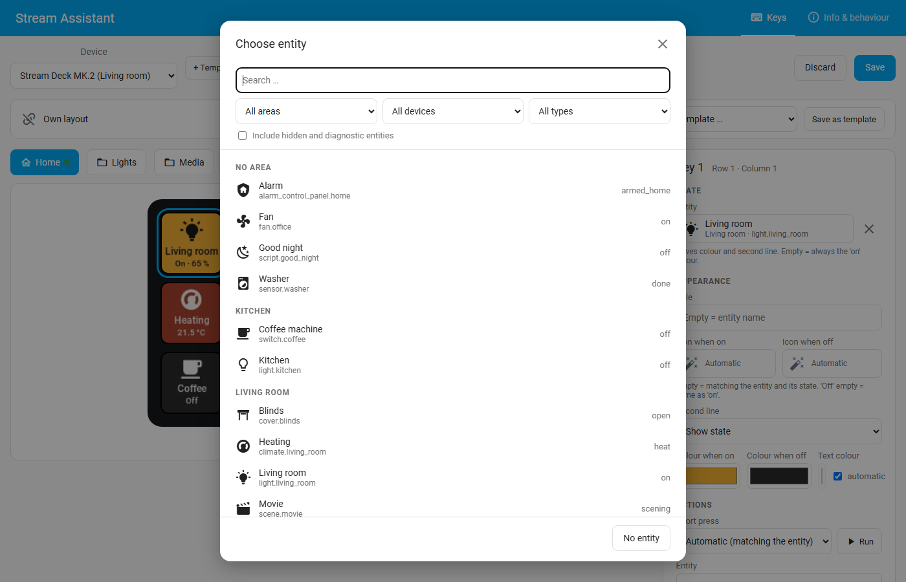
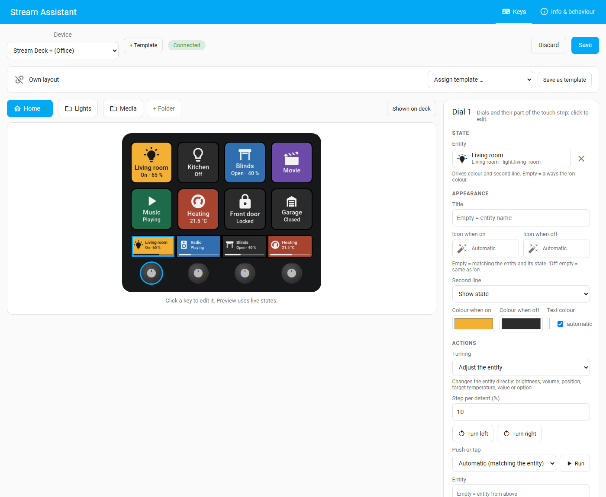
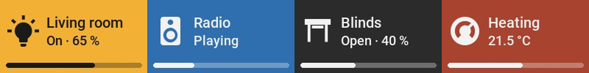
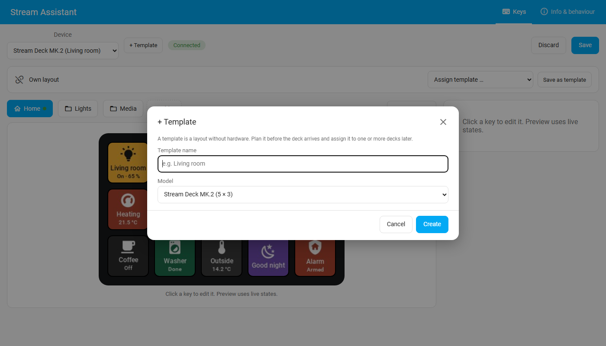
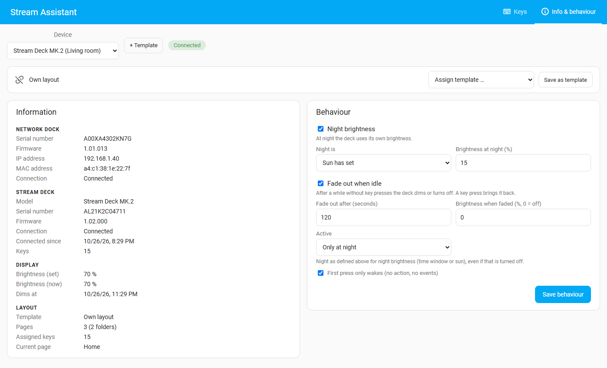

# Key editor

The key editor is in the Home Assistant sidebar: **Stream Assistant** (administrators only).
At the top you choose a **device** (a deck or virtual panel) or a **template**. Two views:

- **Keys:** pages, keys, dials and what they do.
- **Info & behaviour:** facts about the deck, night brightness and fading out when idle.

The preview shows the keys exactly as the deck draws them, with the live states of their
entities. Changes are not applied until you choose **Save**; **Discard** loads the stored
version again. If someone else saved the same layout meanwhile, the editor says so instead
of overwriting it.

## Pages and folders

Every deck starts with one page, **Home**. **+ Folder** adds a folder: a page of its own
that a key opens. In a folder the **first key always goes back** to the page above.
Folders can contain folders. Rename or delete the current folder with the buttons next to
the tabs (deleting removes its keys too).

**Show on deck** switches the real deck to the page you are editing; the tab of the page
the deck shows is marked with a dot.

## Keys

Click a key in the preview to edit it.

**State**

- **Entity:** the key follows it: the colour shows on/off, the second line its state, and
  the icon changes with it (open/closed, on/off …). Without an entity the key always uses
  its "on" colour.

**Appearance**

- **Title:** first line; empty uses the entity's name.
- **Icon when on / when off:** any [Material Design icon](https://pictogrammers.com/library/mdi/),
  picked with a search; *Automatic* chooses one matching the entity and its state.
- **Second line:** the entity's state (with brightness, position, temperature or value and
  unit where it has one), your own text, or nothing.
- **Colours:** background when on, when off, and the text colour (automatic: black or white,
  whatever is readable).

Entities are chosen from a list with search and filters by area, device and type; icons
from a searchable list with suggestions that fit the entity:

**Actions** for a **short press** and a **long press** (held 0.5 s):

| Action | What it does |
|---|---|
| None | Nothing (the key's events still fire) |
| Automatic | The obvious thing for the entity: toggle lights, switches, fans, covers; play/pause media; run scenes and scripts; press buttons; lock/unlock; start/return a vacuum; trigger an automation … The editor shows what it runs |
| Open folder / page | Shows another page |
| Back | Back to the page above |
| Call action | Any Home Assistant action, e.g. `light.turn_on`, with data as JSON, e.g. `{"entity_id": "light.kitchen", "brightness_pct": 40}` |

When a key has no long-press action, its short press runs **as the key goes down**, which
feels instant. With a long-press action, the short press runs on release before 0.5 s.

**Run** next to an action does it now, exactly like a press on the deck (events and action),
also with unsaved changes. **Clear key** empties the key.

## Dials and touch strip

Decks with dials (Stream Deck +, Studio, virtual decks with dials) show them below the keys;
the Stream Deck + also shows its touch strip, one part above each dial. Click a dial or its
part of the strip to edit it.

A dial has the same **state** and **appearance** fields as a key. On the touch strip its
part shows icon, title, state and a **level bar** (brightness, volume, position, target
temperature, value). On the Studio the dial's LED ring shows the colour and the level.

**Turning:**

| Setting | What turning does |
|---|---|
| Nothing | Only the dial's events fire |
| Adjust the entity | Changes the entity directly. **Step per detent** (empty = sensible default) |
| One action per detent | Runs the *turn left* or *turn right* action once per detent (at most 5 per turn) |

What *Adjust the entity* changes:

| Entity | Turning changes | Default step |
|---|---|---|
| Light | Brightness (turning down to 0 turns it off; up from off turns it on) | 5 % |
| Media player | Volume | 2 % |
| Cover | Position | 5 % |
| Fan | Speed | the fan's own step, else 5 % |
| Climate | Target temperature | the device's own step, else 0.5° |
| Number, input number | Value, within its range | its own step |
| Select, input select | Next / previous option | – |

Fast turning is collected into one change, so the light or player is not flooded with
commands. **Push or tap** and **Long push or hold** are the short and long actions, run by
pushing the dial or by tapping or holding its part of the touch strip. Test buttons run
both directions and both pushes.

Swiping the touch strip fires events only (see [Automations](automations.md)).

## Page buttons and screen (Stream Deck Neo)

The Neo's two page buttons need no setup: the left one shows the **previous page**, the right
one the **next page**, in the order of the tabs in the editor. A button is lit when there is a
page in its direction. The small screen shows the name and number of the page shown.

## Templates

A template is a layout that is not tied to one deck:

- **Plan before the hardware arrives:** **+ Template**, give it a name and choose a model
  (every supported Stream Deck) or a free grid (columns, rows, dials).
- **Share a layout:** assign the same template to several decks (*Assign template …*). They
  all show it; editing it on any of them changes it everywhere.
- **Different sizes:** a template can be assigned to decks of another size. Keys keep their
  row and column; keys that do not fit are not shown on that deck (the editor tells you how
  many), and editing on the smaller deck never deletes them from the template.
- **Save as template** turns a deck's own layout into a template and links the deck to it.
- **Detach** gives a linked deck its own copy, which no longer follows the template.
- **Delete template:** linked decks keep a copy of the layout.

## Info and behaviour

**Info** shows serial numbers, firmware, addresses, the connection and since when it is up,
brightness (set and current), the template and how many pages and keys are set up.

**Behaviour** (per deck; *Save behaviour* to apply):

- **Night brightness:** at night the deck uses its own brightness. Night is a **time window**
  (may cross midnight) or **after sunset** (until sunrise).
- **Fade out when idle:** after a number of seconds without a press the deck dims to a
  brightness (0 = off). Any press brings it back. **First press only wakes** makes that press
  do nothing else, so a dark deck is not operated blindly. **Active**: always, only at night,
  or in its own time window.

The brightness itself is the deck's `number` entity (for example on a dashboard or in an
automation). Decks without a display, such as the Pedal, have no brightness and never only wake.
