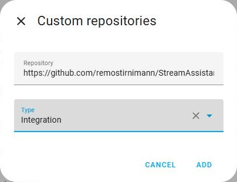

# Installation

## Requirements

- **Home Assistant 2026.10** or later.
- One way to reach a deck (see [Devices and status](devices.md)):
  - an **Elgato Stream Deck Network Dock** with a Stream Deck, or
  - a **computer** (Windows, macOS or Linux) for the [Stream Assistant Bridge](bridge.md),
    with Stream Decks plugged in by USB, or
  - nothing at all, for a **virtual panel** on a dashboard.
- The Elgato Stream Deck app, Bitfocus Companion or other software must **not** use the
  same deck at the same time. A dock or a deck can only be driven by one program.

## Install with HACS (recommended)

Stream Assistant is not in the HACS default list yet; add it as a custom repository:

1. In Home Assistant open **HACS**.
2. Open the menu (⋮, top right) and choose **Custom repositories**.
3. Repository: `https://github.com/remostirnimann/StreamAssistant`, type: **Integration**. Add it.

   

4. Search for **Stream Assistant** in HACS, open it and choose **Download**.
   As long as only beta versions exist, turn on *Show beta versions* in the
   repository's menu if HACS offers no version.
5. **Restart Home Assistant** (*Settings → System → Restart*).

Then continue with the [Setup](setup.md).

## Install by hand

1. Download `stream_assistant.zip` from the
   [releases page](https://github.com/remostirnimann/StreamAssistant/releases).
2. Unpack it into `config/custom_components/stream_assistant/` on your Home Assistant
   (the folder must contain `manifest.json` directly).
3. Restart Home Assistant.

## Updating

- **HACS:** HACS shows an update for Stream Assistant; install it and restart Home
  Assistant.
- **By hand:** replace the folder `config/custom_components/stream_assistant/` with the
  new release and restart.

Layouts, templates, behaviour settings and pairings are stored in Home Assistant and
kept across updates. After an update, reload the browser page once if the key editor
still shows the old version.

If you use the [bridge](bridge.md), update it to the same version: the integration and
the bridge are released together.

## Removing

1. *Settings → Devices & services → Stream Assistant*: delete each entry. This also
   deletes the stored layouts of its decks. Templates are not part of an entry and stay
   stored; delete them in the key editor first if you no longer want them.
2. Remove the integration in HACS (or delete `config/custom_components/stream_assistant/`).
3. Restart Home Assistant.

The decks show the Elgato logo again when Home Assistant lets go of them.
