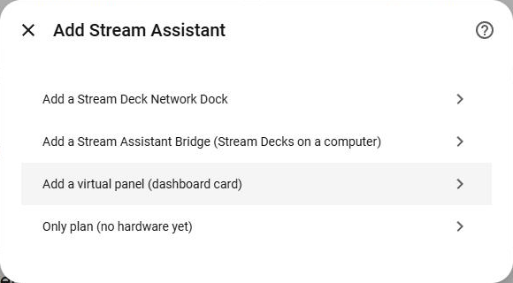
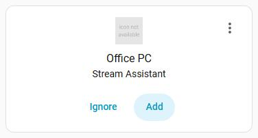
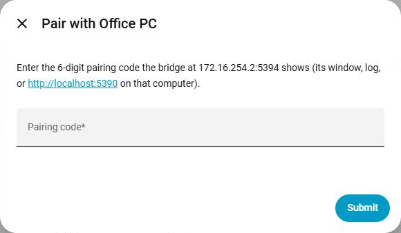
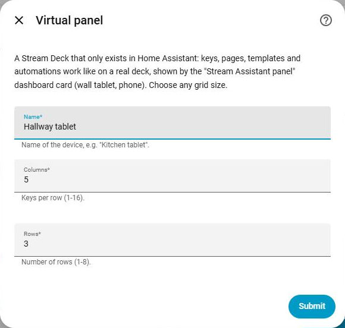
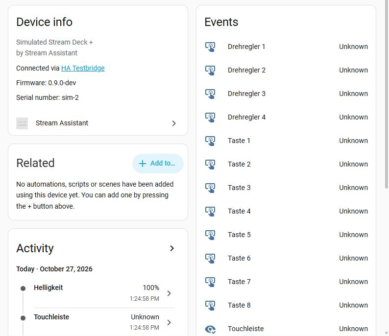

# Setup

After the [installation](installation.md), add Stream Assistant under
**Settings → Devices & services → Add integration → Stream Assistant**. A menu asks
what to add:

| Choice | For |
|---|---|
| **Stream Deck Network Dock** | A Stream Deck on an Elgato Network Dock |
| **Stream Assistant Bridge** | Stream Decks on a computer running the [bridge](bridge.md) |
| **Virtual panel** | A deck that only exists in Home Assistant, shown on a dashboard |
| **Only plan** | No hardware yet: enables the key editor to plan templates |

You can add as many docks, bridges and virtual panels as you like; each is its own
entry. Then design the keys in the [key editor](editor.md) (sidebar: *Stream Assistant*).

## Network Dock

The Elgato Stream Deck Network Dock connects one Stream Deck to your network (Ethernet,
optionally powered over PoE).

1. Connect the dock to the network and plug the Stream Deck into it.
2. Close the Elgato Stream Deck app and Companion on all computers: a dock accepts only
   one client.
3. Home Assistant usually finds the dock on its own: *Settings → Devices & services*
   shows **Discovered: Stream Deck Network Dock**. Choose *Add* and confirm.
   Otherwise choose *Stream Deck Network Dock* in the menu and enter the dock's IP address.

   

The dock is identified by its serial number. When it gets a new IP address,
Home Assistant follows it (mDNS and DHCP), so you do not need a fixed address.
If you plug a different Stream Deck into the dock, the entry adapts to the new model.

You get one device for the dock and one for the Stream Deck.

## Stream Assistant Bridge

1. Install and start the [bridge](bridge.md) on the computer with the Stream Decks.
2. Home Assistant usually finds it: *Discovered: Stream Assistant Bridge*. Otherwise
   choose *Stream Assistant Bridge* and enter the computer's address (port 5390).
3. Enter the **pairing code**: six digits shown by the bridge (in its window, in its log,
   or on `http://localhost:5390` on that computer). The code is shown only on the
   computer itself, so nobody else on the network can pair.

   

You get one device for the bridge and one per deck on it. Decks appear and disappear
with USB plugging; once seen, a deck keeps its entities and layout while it is unplugged.
If the bridge forgets the pairing (for example after `--unpair-all`), Home Assistant asks
for a new code: *Settings → Devices & services* shows the entry as needing re-authentication.

## Virtual panel

A virtual panel has no hardware: it is shown and pressed on a dashboard, for example on
a wall tablet or a phone.

1. Choose *Virtual panel*, enter a name and the grid: 1–16 columns, 1–8 rows.

   

2. Add the card to a dashboard: *Edit dashboard → Add card →* **Stream Assistant panel**,
   and choose the panel. Options: gap between keys, show the title.

All users who can see the dashboard can press the keys; only administrators can change
them. The grid can be changed later: on the entry choose **Reconfigure**. Keys keep their
row and column; keys outside the new grid are removed. More in
[Virtual and simulated panels](virtual-panels.md).

## Only plan (no hardware yet)

Adds the key editor without any deck. Create [templates](editor.md#templates) for decks
you do not have yet and assign them later. You can keep this entry or delete it once
real decks are set up; templates are not deleted with it.

## What you get in Home Assistant

Per deck (the names follow the device; you can rename them):

| Entity | What it does |
|---|---|
| `event.<deck>_key_<n>` | One per key. Fires `pressed`, `released`, `short_press` and `long_press` (after 0.5 s) |
| `event.<deck>_dial_<n>` | One per dial (Stream Deck +, Studio). Fires `rotate_left` / `rotate_right` (with `steps`) and the press events |
| `event.<deck>_touch_strip` | Stream Deck +: `tap`, `long_press`, `swipe_left`, `swipe_right`, with position and the dial below it |
| `event.<deck>_page_button_<n>` | Stream Deck Neo: the two page buttons, press events |
| `number.<deck>_brightness` | Brightness in percent, restored after restarts (not for decks without a display, such as the Pedal) |
| `binary_sensor.<deck>_connected` | Whether the deck is connected (not for virtual panels) |
| `binary_sensor.<dock or bridge>_connected` | Whether the dock or bridge is reachable |

Keys are numbered from 1 in the entity names, left to right and top to bottom; the
event attributes `key`, `row` and `column` count from 0. See [Automations](automations.md)
for how to use them.
