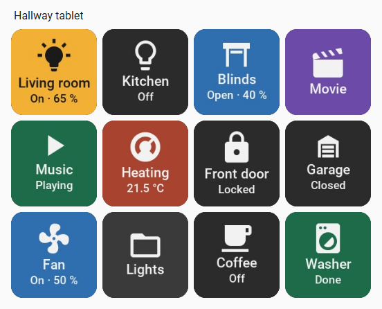
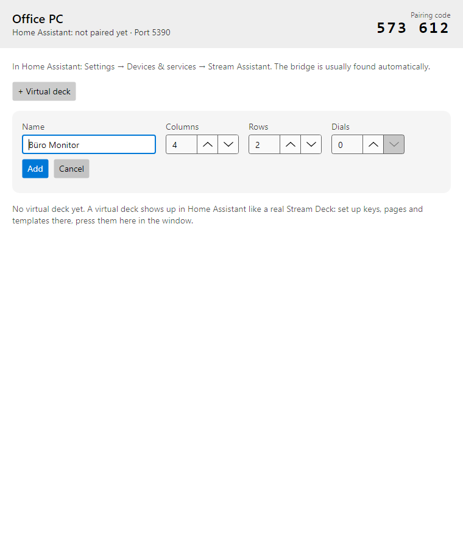
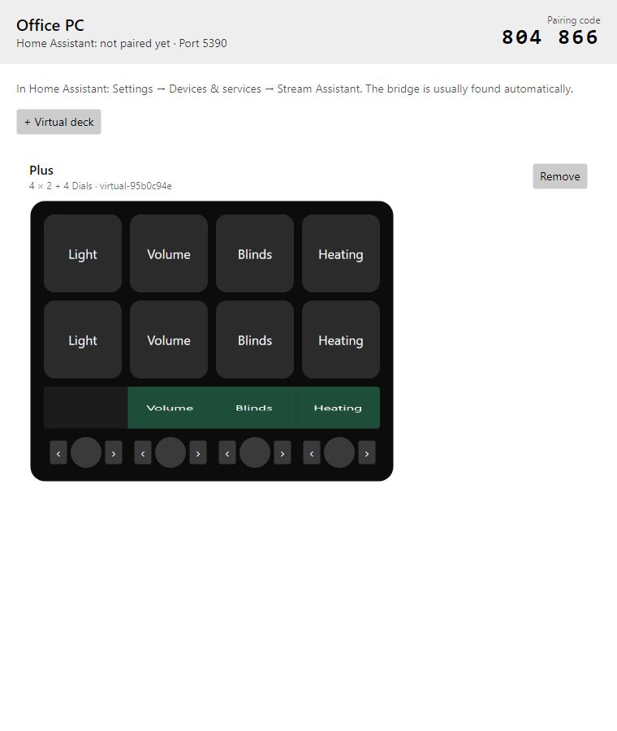
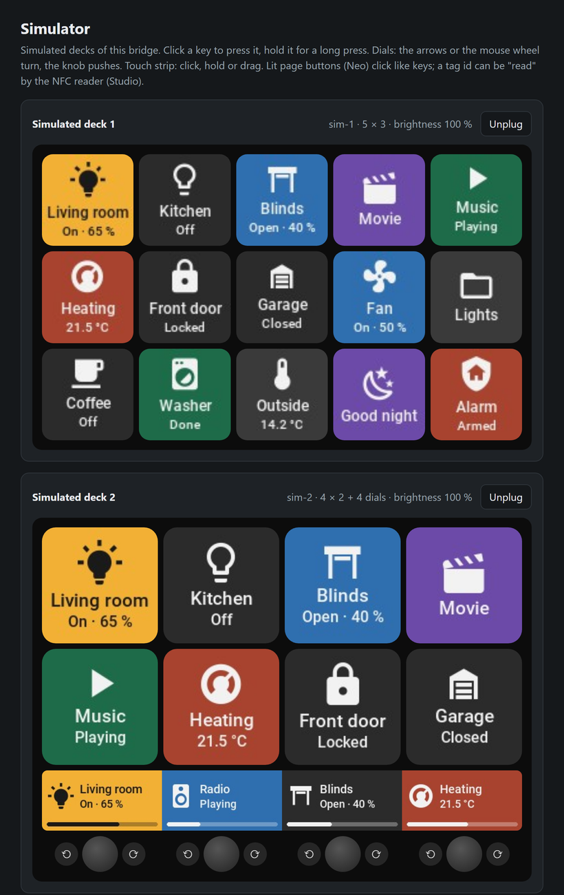

# Virtual and simulated panels

Three kinds of panels work without a Stream Deck. In Home Assistant they behave exactly
like real decks: the same key editor, templates, entities, events and actions.

| Kind | Lives in | Pressed on | Good for |
|---|---|---|---|
| [Virtual panel](#virtual-panels-in-home-assistant) | Home Assistant | a dashboard card (tablet, phone, browser) | Wall tablets, phones, any grid size |
| [Virtual deck](#virtual-decks-in-the-bridge-window) | the bridge desktop app | the bridge window on a computer | A deck on your monitor next to your work |
| [Simulated deck](#simulated-decks) | the bridge (`--simulate`) | the simulator page in a browser | Trying layouts, testing, demos, development |

## Virtual panels in Home Assistant

A virtual panel needs no bridge and no hardware.

1. *Settings → Devices & services → Add integration → Stream Assistant →* **Virtual panel**.
2. Name it and choose the grid: **1–16 columns** and **1–8 rows**. Any number of panels can
   exist side by side.
3. Design its keys in the [key editor](editor.md).
4. Show it on a dashboard: *Edit dashboard → Add card →* **Stream Assistant panel**. Choose
   the panel; optionally set the gap between keys and whether the panel's name is shown above it.



<!-- TODO image: images/ha-card-picker.png – Add card dialog with the Stream Assistant panel card and its editor (list: docs/images/README.md) -->

<!-- TODO image: images/photo-wall-tablet.jpg – photo, optional: a wall tablet showing a virtual panel (list: docs/images/README.md) -->

In YAML:

```yaml
type: custom:stream-assistant-card
entry_id: 01J…        # chosen in the card editor
gap: 8                 # pixels between keys
show_title: true
```

Using the card:

- **Tap** a key for a short press, **hold** it for a long press (0.5 s), exactly like a real key.
- Images are rendered at 144 px per key, sharp on high-resolution tablets.
- The panel's brightness setting dims the keys on the card; night brightness and fading
  out when idle (see [behaviour](editor.md#info-and-behaviour)) work too.
- **Every user** who can see the dashboard can press the keys. Only **administrators** can
  change the layout in the key editor.
- The same panel can be on several dashboards and devices at once; all show the same keys.

To change the grid later: on the panel's entry choose **Reconfigure**. Keys keep their row
and column; keys that no longer fit are removed (and so are their event entities).

Virtual panels have keys only; dials, touch strips and page buttons are for real decks and
the bridge's virtual decks.

## Virtual decks in the bridge window

The desktop version of the [bridge](bridge.md) can show decks in its window. Home Assistant
sees them as decks of that bridge, like Stream Decks on USB.

1. Start `stream-assistant-bridge-desktop` and pair it with Home Assistant
   ([Setup](setup.md#stream-assistant-bridge)).
2. In the window choose **+ Virtual deck**: a name, **columns (1–16)**, **rows (1–8)** and
   **dials (0–6)**. With dials, the deck also gets a touch strip above them, like a
   Stream Deck +.
3. The deck appears in Home Assistant right away; design it in the key editor.





Using it in the window:

- Click a key for a short press, hold it for a long press.
- Dials: the arrows **‹ ›** or the **mouse wheel** turn, clicking the knob pushes it.
- Touch strip: click to tap, hold to long-press, drag to swipe.
- **Remove** asks for a second click to confirm.

Virtual decks are stored in the bridge's `bridge.json` and come back when the bridge
restarts; Home Assistant keeps their layouts.

## Simulated decks

Simulated decks are meant for trying things out and for development. They exist while the
bridge runs and are driven from a web page.

Start the bridge (console or desktop) with `--simulate` and a comma-separated list:

```bash
stream-assistant-bridge --simulate 5x3,4x2:4,neo
```

| Value | Simulates |
|---|---|
| `5x3` | A deck with 5 columns and 3 rows (up to 16×16), 72 px keys |
| `4x2:4` | The same with 4 dials and a touch strip (1–8 dials) |
| `mk2`, `xl`, `plus`, `mini`, `original`, `pedal`, `neo`, `studio` | That Elgato model with all its controls: dials, touch strip, page buttons, screen, LED rings, NFC |

Open **`http://localhost:5390/sim`** on the bridge computer (only there). The simulator page:




- shows every simulated deck with its keys as Home Assistant draws them, and its brightness,
- presses keys (click, hold for a long press), turns and pushes dials, taps, holds and
  swipes the touch strip, presses page buttons,
- shows page buttons in their colour, the screen and the LED rings,
- can "read" an NFC tag on a simulated Studio (enter an id, *Read tag*),
- plugs each deck in and out (*Unplug* / *Plug in*), to see how Home Assistant reacts.

The decks are named `sim-1`, `sim-2`, … in the order given; Home Assistant remembers them
like real decks, so start the bridge with the same list to get the same decks back.
